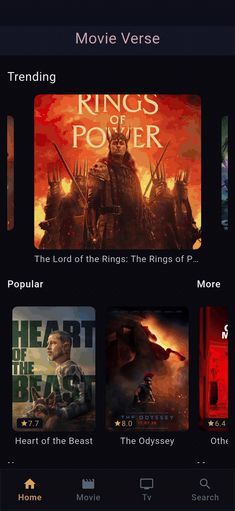
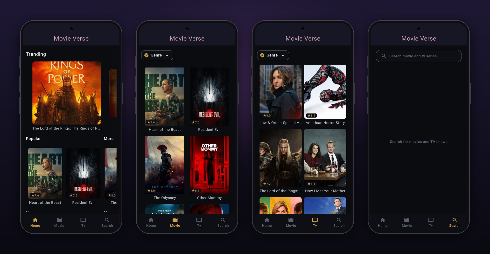
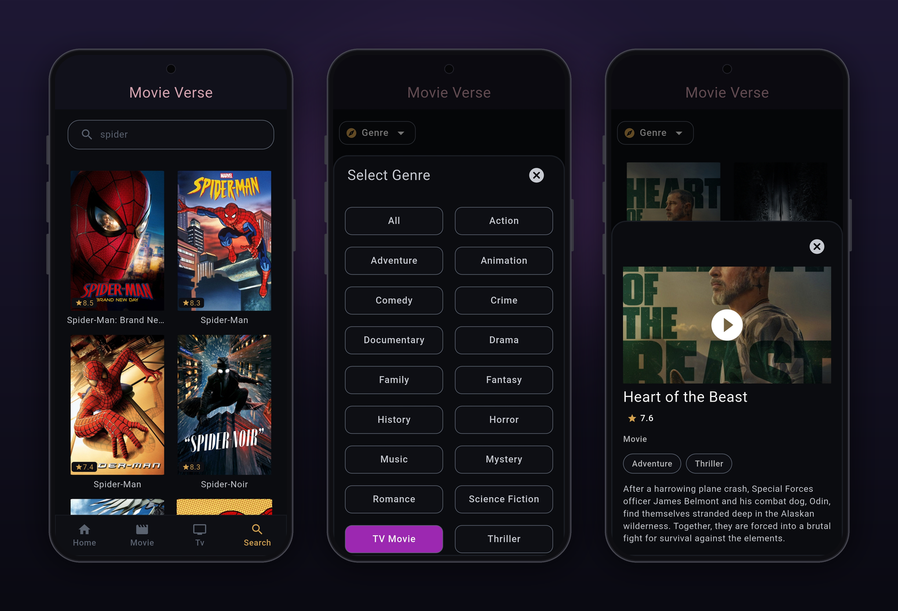

# 🎬 MovieVerse

**MovieVerse** is a Flutter project where I explored working with movie and TV show data using the TMDB API. The app lets users browse popular movies, discover TV shows, search for titles, and view movie details.

One of the main features is the integrated YouTube player, which allows users to watch movie trailers directly from the app.

I built this project using Flutter, BLoC, and Clean Architecture. My main focus was to keep the code organized, understand how different layers work together, and get more hands-on experience with API integration and state management.

---

##  Features

Here are some of the features I have implemented in MovieVerse:

- 🎥 **Movie Discovery** – Browse popular and trending movies.
- 📺 **TV Shows** – Explore and discover different TV shows.
- 🔍 **Search** – Search for movies and TV shows.
- 🎬 **Movie Details** – View information about selected movies.
- ▶️ **Trailer Playback** – Watch movie trailers using the YouTube player.
- 🌐 **TMDB API Integration** – Fetch movie and TV show information from TMDB.
- 🔄 **Pagination** – Load more movies and TV shows while browsing.
- 📡 **Network Connectivity** – Detect internet connection changes and handle offline states.
- 🔃 **Pull to Refresh** – Refresh content when needed.
- 💀 **Shimmer Loading** – Display loading placeholders while waiting for API responses.
- 🧩 **BLoC State Management** – Handle application states and user interactions.
- 🏗️ **Clean Architecture** – Separate data, business logic, and presentation code.

---

## 🛠️ Technologies & Packages

These are the main technologies and packages I used while developing this project.

| Technology / Package   | Purpose                      |
| ---------------------- | ---------------------------- |
| Flutter & Dart         | Application development      |
| TMDB API               | Movie and TV show data       |
| Flutter BLoC           | State management             |
| HTTP                   | API requests                 |
| GetIt                  | Dependency injection         |
| Equatable              | Value equality               |
| Flutter Dotenv         | Environment variable support |
| Cached Network Image   | Network image caching        |
| Carousel Slider        | Movie carousel               |
| YouTube Player Flutter | Trailer playback             |
| Connectivity Plus      | Internet connectivity        |
| Shimmer                | Loading effects              |
| Lottie                 | Animations                   |
| Bloc Concurrency       | BLoC event handling          |
| Stream Transform       | Stream transformations       |

---

## 🏗️ Project Architecture

MovieVerse follows Clean Architecture with a feature-based folder structure. Each feature is separated into Data, Domain, and Presentation layers. Shared components and services are managed inside the Core folder.

### Project Structure

```text
lib/
│
├── app/
│   ├── assets/
│   └── pages/
│       ├── main_navigation_screen.dart
│       └── splash_screen.dart
│
├── core/
│   ├── constants/
│   ├── cubit/
│   ├── di/
│   ├── error/
│   ├── helpers/
│   ├── service/
│   ├── theme/
│   ├── utils/
│   └── widgets/
│
├── features/
│   ├── home/
│   ├── movie/
│   ├── search/
│   ├── tv_show/
│   └── video/
│
├── main.dart
└── my_app.dart
```

### Core Modules

- **API & Services:** Handles TMDB API requests and network responses.
- **State Management:** Manages shared states such as genres and network connectivity.
- **Dependency Injection:** Registers application dependencies using GetIt.
- **Error Handling:** Provides common error and exception handling.
- **Helpers & Utilities:** Contains reusable helper functions, routing, and pagination logic.
- **Theme:** Manages application colors and text styles.
- **Reusable Widgets:** Contains shared UI components for media cards, grids, trailers, and error states.

### Feature Modules

Each feature follows the same Data, Domain, and Presentation structure:

- **Home:** Movie discovery and home screen.
- **Movie:** Movie information and details.
- **Search:** Search for movies and TV shows.
- **TV Show:** Browse TV shows.
- **Video:** Movie trailer playback.

---

## 🎬 App Demo

Here is a quick look at MovieVerse and some of its main features.

<p align="center">
  
</p>

---

## 📸 App Screenshots

Here are some screenshots from MovieVerse, showing the main screens and a few of its features.

<p align="center">
  
</p>

<p align="center">
  
</p>


---

##  Getting Started

If you want to run this project on your local machine, follow these steps.

### Prerequisites

Make sure you have the following installed:

- Flutter SDK
- Dart SDK
- VS Code or Android Studio
- A TMDB account and API key

### 1. Clone the Repository

```bash
git clone https://github.com/codedbymahfuz/movie_verse.git
```

### 2. Navigate to the Project

```bash
cd movie_verse
```

### 3. Install Dependencies

```bash
flutter pub get
```

### 4. Get a TMDB API Key

MovieVerse uses the TMDB API to retrieve movie and TV show information.

1. Visit [The Movie Database](https://www.themoviedb.org/).
2. Create an account or sign in.
3. Open your account settings.
4. Generate an API key.

### 5. Configure the API Key

The API key configuration file is excluded from version control for security reasons.

After cloning the project, create your local API key configuration file at:

```text
lib/core/utils/api_key.dart
```

Add your TMDB API key using the same variable and class structure expected by the project's API configuration.

**Note:** The `api_key.dart` file is listed in `.gitignore`, so it is not included in the repository.

### 6. Run the Application

To run the app on your connected device or emulator:

```bash
flutter run
```

To run the Windows desktop version:

```bash
flutter run -d windows
```

---

## 📚 What I Learned

Working on MovieVerse gave me the opportunity to practice and understand several Flutter development concepts.

Some of the things I worked on include:

- Organizing a Flutter project using Clean Architecture.
- Managing application state with BLoC.
- Connecting a Flutter application to REST APIs.
- Working with repositories and data sources.
- Setting up dependency injection using GetIt.
- Handling asynchronous API requests and responses.
- Implementing pagination for movie and TV show lists.
- Integrating YouTube video playback.
- Handling internet connectivity and offline states.
- Working with streams and BLoC event transformations.
- Building reusable widgets and keeping the code organized.

---

## 📦 Main Dependencies

For more details about the packages used in this project, check the [pubspec.yaml](pubspec.yaml) file.

Some of the main packages:

- [flutter_bloc](https://pub.dev/packages/flutter_bloc)
- [http](https://pub.dev/packages/http)
- [get_it](https://pub.dev/packages/get_it)
- [equatable](https://pub.dev/packages/equatable)
- [flutter_dotenv](https://pub.dev/packages/flutter_dotenv)
- [cached_network_image](https://pub.dev/packages/cached_network_image)
- [carousel_slider](https://pub.dev/packages/carousel_slider)
- [youtube_player_flutter](https://pub.dev/packages/youtube_player_flutter)
- [connectivity_plus](https://pub.dev/packages/connectivity_plus)
- [shimmer](https://pub.dev/packages/shimmer)
- [lottie](https://pub.dev/packages/lottie)

---

## 👨‍💻 Developer

**Mahfuz**
Flutter Developer

- GitHub: [@codedbymahfuz](https://github.com/codedbymahfuz)

---

## 🙏 Acknowledgements

- [The Movie Database (TMDB)](https://www.themoviedb.org/) for providing movie and TV show data.
- Flutter and the open-source community for the tools and packages used in this project.

**Disclaimer:** This product uses the TMDB API but is not endorsed or certified by TMDB.

---

Thanks for checking out MovieVerse! 